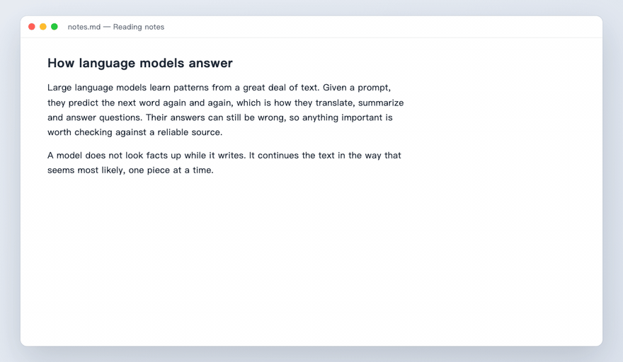
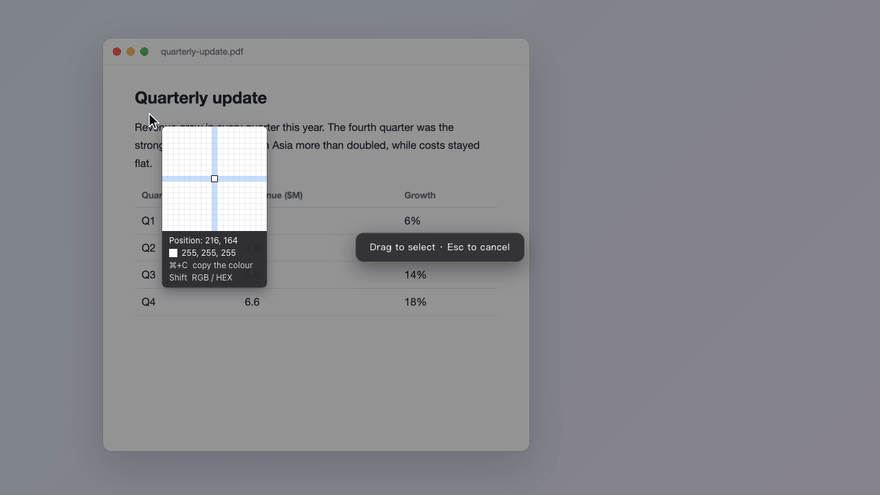
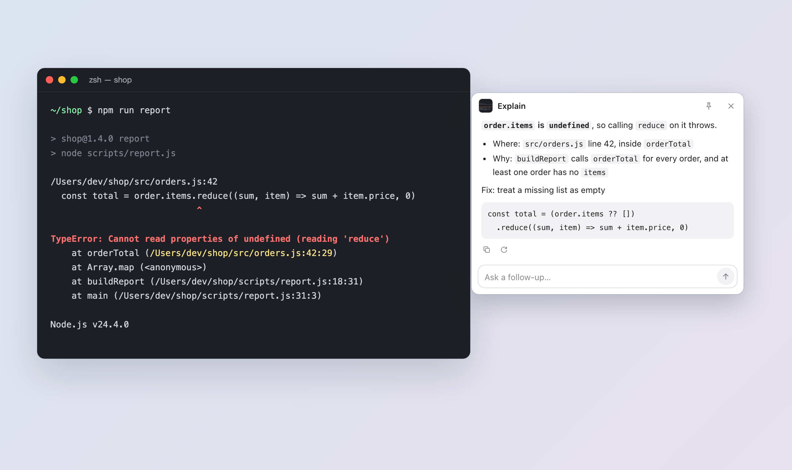
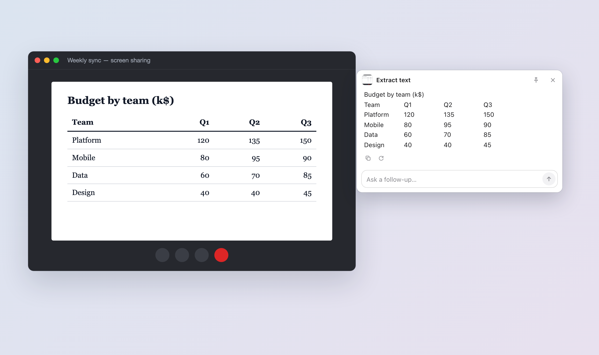
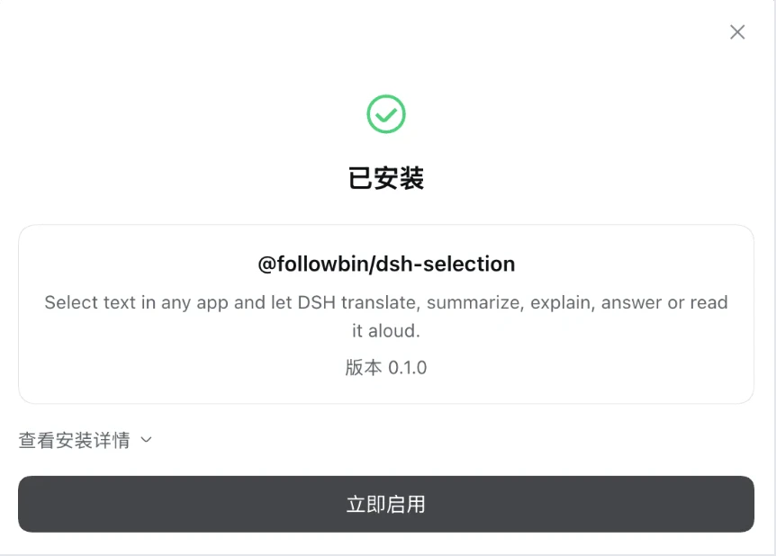
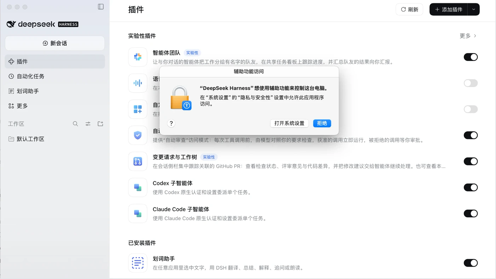

# Selection + Screenshot

[中文](README.zh-CN.md) · a [DeepSeek Harness](https://github.com/deepseek-ai/deepseek-harness) plugin · `@followbin/dsh-selection`

**Select text or capture part of the screen, and let AI work on it right there.** Translate, explain, summarize, extract text or answer a question; the answer appears where you are, and you can keep asking. It uses the models you already set up in DeepSeek Harness (DSH), so there is no extra API key.

## Selection: select, then ask



- **Select text in any app** and a toolbar appears next to it: Translate, Summarize, Explain, Ask DSH, Polish, Read aloud, Copy, Search.
- **Answers stream in place**, with a box underneath for follow-ups that keep the context ("more formal", "give an example").
- **One instruction makes a new skill**: give it a name, pick an icon, write what it should do.
- It never takes focus and floats above full-screen apps; the mini mode shrinks it to a single icon.

## Screenshot: capture, then ask



- **⌥D (Alt+D on Windows) captures a region of any display** for a model that reads images:
  - **Extract text** from pictures, scans and screen shares, with tables kept in rows and columns, ready to paste into a spreadsheet;
  - **Translate**, **Explain** (errors, charts, interfaces) or **Ask** anything; add your own screenshot actions too.
- **Mark what matters, then ask**: boxes, arrows and other annotations go to the model with the image.
- **The answer opens beside the capture**, with follow-ups, copy and pin.
- It is a complete capture tool as well: annotate, copy, save, or pin the capture on screen.

<p>
  
  
</p>

## Install

You need DSH Desktop 0.2.2 or later, on macOS 14 or later or Windows 10/11. The screenshots show DSH in Chinese; the English interface is laid out the same way.

1. In DSH, open **Plugins** in the sidebar, click **Add plugin**, enter `@followbin/dsh-selection` and click **Install**.

   

2. When the dialog says **Installed**, click **Enable now**.

   

3. macOS asks for the Accessibility permission. Choose *Open System Settings* (the highlighted default button is *Deny*) and switch DeepSeek Harness on.

   

Then select some text in any app, or press ⌥D. Settings are under **Selection + Screenshot** in DSH's sidebar.

- **Updating**: open the plugin under **Plugins**; when **Versions** lists a new one, click **Update**.
- **Newest code from GitHub**: enter `https://github.com/followbin/dsh-selection` in step 1. Such a copy has no **Versions** section; to update it, uninstall and install again.
- Settings and usage live in `~/.dsh/selection`, so uninstalling keeps them.

## Permissions (macOS)

Both permissions are granted to DeepSeek Harness, each asked for the first time it is needed, never both at once:

| Permission | Asked | Used for |
| --- | --- | --- |
| Accessibility | When the plugin first runs | Reading the selected text. Without it the toolbar never appears. |
| Screen & System Audio Recording | The first time you press ⌥D | Reading the screen. It works as soon as you allow it, without a restart. |

The capture shortcut itself needs no permission. The settings page says at the top which permission is missing.

Note that macOS counts these permissions for every process DSH starts, including commands an agent runs. If that is not acceptable, do not grant them; you can turn them off any time under System Settings → Privacy & Security. Windows needs no extra permission.

## Using it

**Selection**

- The toolbar appears below the selection; Esc, clicking elsewhere or typing hides it.
- **Ask DSH** opens a small conversation about the selected text. Every answer has a box for follow-ups; regenerating or switching language starts over.
- Drag the toolbar or a panel out of the way. The pin keeps a panel on screen; a translation panel can switch its target language.
- The **⋯** menu switches to the mini mode, disables the toolbar in the current app, or opens the settings.

**Screenshot**

- ⌥D freezes every display; drag out a region, then move or resize it. The magnifier next to the pointer shows the position and colour: ⌘C copies the colour, Shift switches RGB/HEX.
- Below the region, the first row holds the annotation tools and actions, the second the AI actions; **Ask** opens a box for your question.
- Keys: Enter or ⌘C copy · ⌘S save · ⌘P pin · ⌘Z undo · Delete removes the selected annotation · Esc leaves. Use Ctrl for ⌘ on Windows.
- A pin can be dragged, resized from its corners and zoomed with the wheel; hold ⌥ while scrolling to change its opacity.

## Settings

Open **Selection + Screenshot** in DSH's sidebar. Changes are saved and applied at once.

| Tab | What it holds |
| --- | --- |
| Selection | On/off; toolbar style (full or mini) and when it appears (on every selection, or only while ⌥ / Alt is held); the skills' order, switches and custom skills; copying as a fallback when a selection cannot be read, the most characters sent, the search engine; apps where it never appears. |
| Screenshot | On/off; the shortcut (⌥D / Alt+D by default, with a note when another app holds it or it matches a system shortcut); the save folder (the desktop by default); the screenshot AI actions' order, switches and custom actions (up to 12, each tried on an image before saving). |
| Models & language | Your language, the translation direction and the answer language, shared by both; the text model (DeepSeek Flash first by default) and the image model, each with a test button. |
| Usage | Requests and tokens per day, model and skill; numbers only, kept for 90 days. |

<p>
  
  
</p>

## Privacy

- Text and captures stay on your machine. Only when you choose something that uses a model is the selected text, or the captured region with its annotations, sent to the model you picked in DSH; copy, save and pin never go online.
- Selected text and the contents of an image are treated as material, never as instructions to the model. Answers go through a renderer that emits no raw HTML, and links open only when clicked.
- DSH sends the model requests; the plugin's background processes do not go online. The settings API only answers DSH's signed-in session.
- The log (`~/.dsh/selection/host.log`) records events and counts, never content. There is no telemetry.

## Troubleshooting

- **Installing fails because GitHub cannot be reached**: choose the mirror option and install by package name, `@followbin/dsh-selection`.
- **Installed, but nothing happens**: check on the Plugins page that it is enabled (closing the dialog without **Enable now** leaves it off); restart DSH if it asks.
- **No toolbar on macOS**: check that DeepSeek Harness is on under System Settings → Privacy & Security → Accessibility. If only one app is affected, check it is not in the disabled list and keep the copy fallback on.
- **The capture shortcut does nothing**: read the note under the shortcut on the Screenshot tab; if another app holds it, pick another. A black capture, or one with only the desktop, means the screen recording permission is missing.
- **Model errors**: use the test buttons on the Models & language tab. If no model is available, sign in or add an API key in DSH; screenshot AI needs a model that accepts images.
- **Anything else**: look at `~/.dsh/selection/host.log`, and use **Restart the assistant** or **Restart the screenshot process** on the settings page.

## Known limitations

- While macOS secure input is on (a password field has focus, for example), the system hands over no selection and the toolbar does not appear.
- On Windows, selections in apps running as administrator cannot be read; Smart App Control may block unsigned native modules; screenshots have been tried on real Windows hardware, but not yet on multiple displays with different scaling.
- Read aloud uses the system voices, so its quality depends on which voices are installed.
- Selection and screenshots each run in their own background process, so a fault in one does not take down the other, at the cost of some memory.

## Development

DSH Desktop runs plugins in Electron's Node mode (Node 24), and `@webviewjs/webview` needs Node 24 too, so install dependencies with DSH's own runtime:

```bash
env ELECTRON_RUN_AS_NODE=1 "/Applications/DeepSeek Harness.app/Contents/MacOS/DeepSeek Harness" \
  "/Applications/DeepSeek Harness.app/Contents/Resources/runtime/primary-runtime/dependencies/pnpm/bin/pnpm.mjs" install
```

To run your checkout inside DSH, quit DSH and link the folder in. After that, changes to `src/worker/`, `src/capture/worker/` or `ui/` need only the matching process restarted from the settings page; changes to `index.js`, `client.js`, `src/host/` or `src/capture/host/` need DSH restarted.

```bash
"/Applications/DeepSeek Harness.app/Contents/Resources/runtime/cli/bin/dsh" plugin --profile desktop add link:/path/to/dsh-selection
```

| Command | What it does |
| --- | --- |
| `pnpm test` | Unit tests: the Host, the rules both background processes follow, and the toolbar and settings pages (in jsdom). Any Node 20 or later. |
| `pnpm selftest` | Opens the real toolbar, menu and answer panels, checks the native window state and layout, and that the front app never changed. Add `--interactive` to click around for 20 seconds. |
| `pnpm dev` | Runs the real toolbar outside DSH with a demo model; settings go to `~/.dsh/selection-dev`. |
| `pnpm screenshots` | Redraws the images and animations in `docs/images/` from the real pages with sample content (the install screenshots are taken by hand). Add `zh` / `en` for one language, `selection` / `capture` for one part. Needs Google Chrome and ffmpeg. |
| `pnpm vendor:selection-hook [version]` | Updates `vendor/selection-hook` from npm. |

Browser tests for the capture page: `node test/capture/build-harness.mjs` writes `test/capture/harness.html`; open it and run `await window.__cases.run()`. How the parts fit together: [docs/architecture.md](docs/architecture.md).

## License

MIT; see [LICENSE](LICENSE) and [THIRD_PARTY_NOTICES.md](THIRD_PARTY_NOTICES.md).
