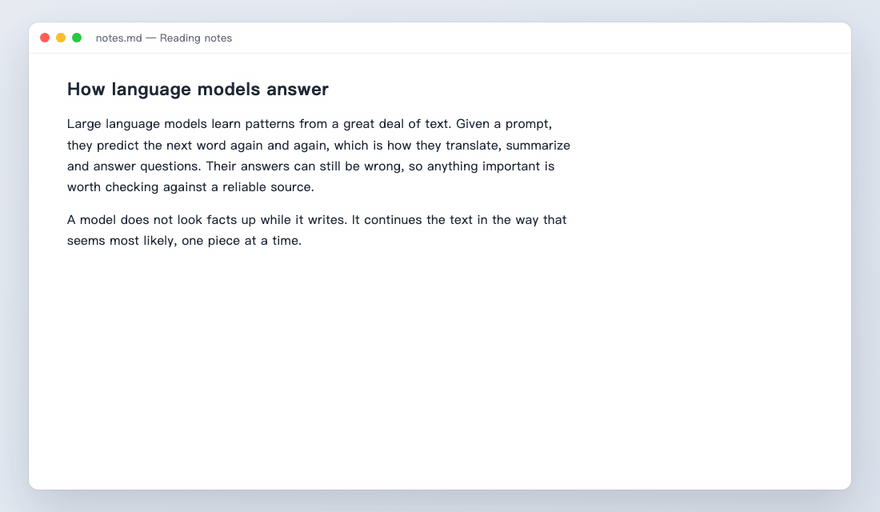
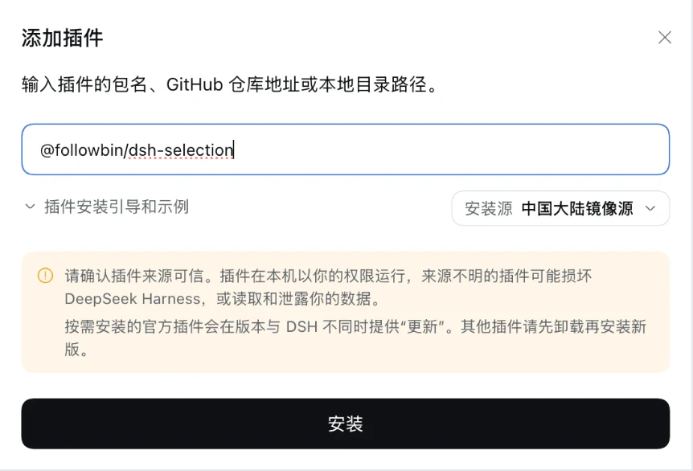
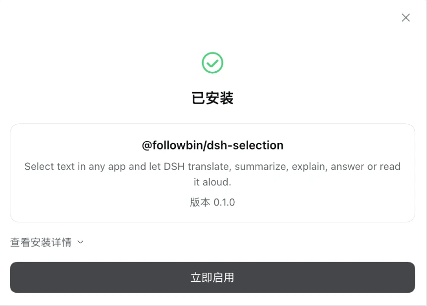
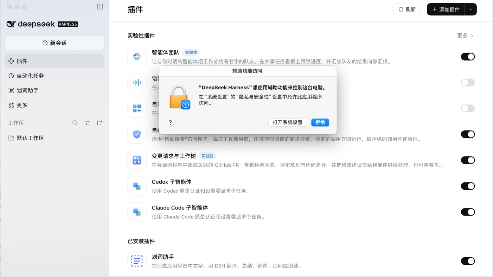
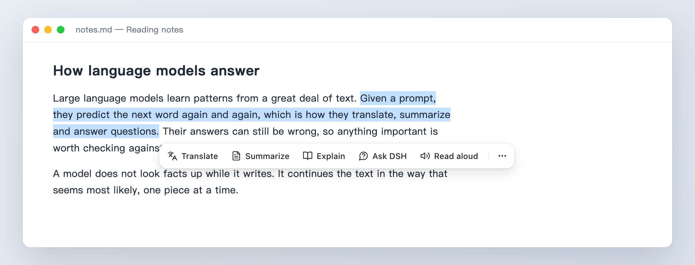
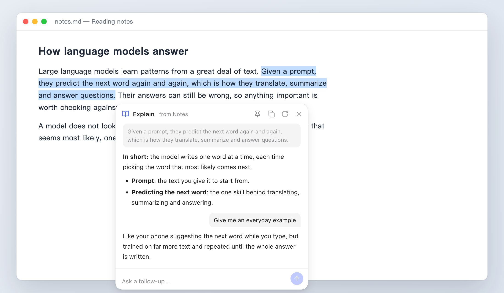
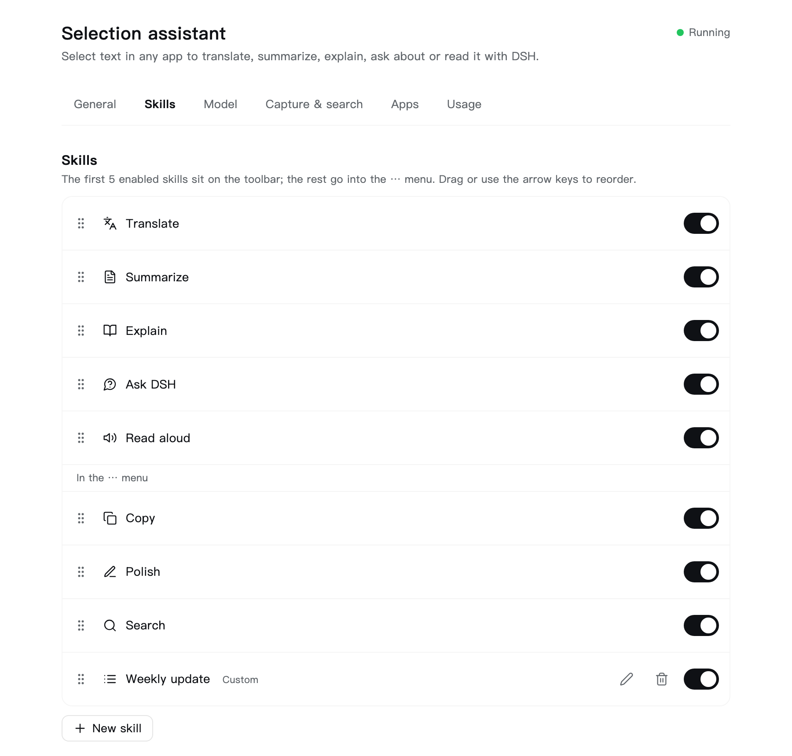
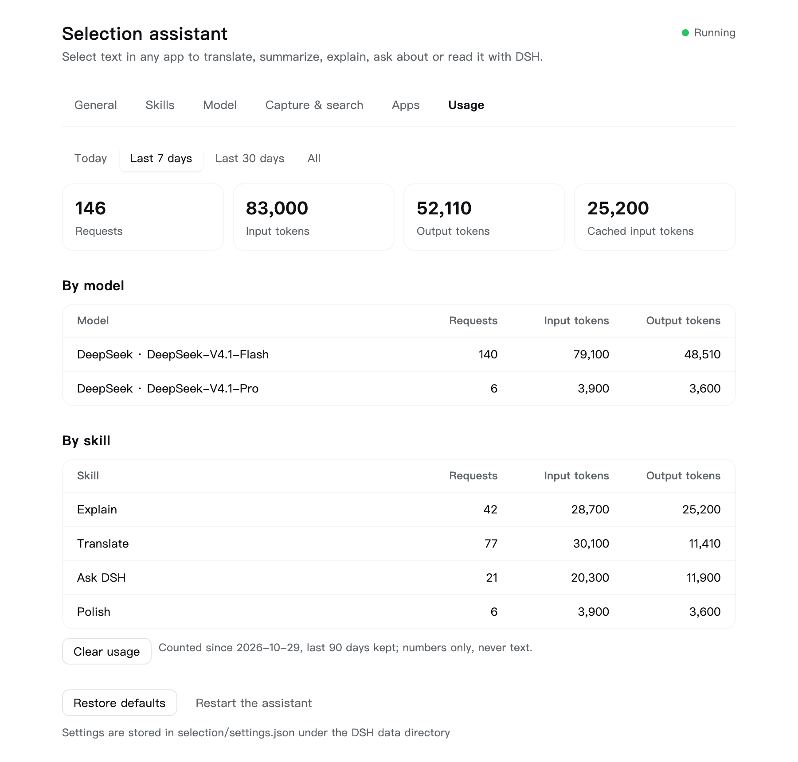

# dsh-selection

[中文](README.zh-CN.md)

Select text in any app and a small toolbar appears next to it: translate, summarize, explain, ask about it, read it aloud, copy, polish or search, with the models you already use in [DeepSeek Harness](https://github.com/deepseek-ai/deepseek-harness) (DSH).



## Install

You need DSH Desktop 0.2.2 or later on macOS 14 or later. Windows support is written but not tested yet; see [Known limitations](#known-limitations). The screenshots below show DSH in Chinese; the English interface is laid out the same way.

1. In DSH, open **Plugins** in the sidebar and click **Add plugin**.
2. Enter `@followbin/dsh-selection` and click **Install**.

   

3. When the dialog says **Installed**, click **Enable now**.

   

4. macOS asks whether "DeepSeek Harness" may control your computer using accessibility features. Choose *Open System Settings* (the highlighted default button is *Deny*) and switch DeepSeek Harness on ([why](#permissions-macos)).

   

Now select some text in any app. Settings are under **Selection assistant** in DSH's sidebar.

To install the newest code from GitHub instead, enter `https://github.com/followbin/dsh-selection` in step 2.

**Updating**: when a new version is published, the plugin's page under **Plugins** lists it in **Versions**; click **Update**. A copy installed from GitHub or a local folder has no **Versions** section: uninstall it and install it again. Your settings and usage are kept, because they are stored in `~/.dsh/selection`, outside the plugin.

## Features

- **Toolbar**: the first few skills sit on the toolbar, the rest live in the ⋯ menu together with "Disable in this app" and "More settings…".
- **Built-in skills**: Translate, Summarize, Explain, Ask DSH, Read aloud, Copy, Polish, Search.
- **Custom skills**: a name, an icon and an instruction. Try them on sample text before saving.
- **Answers stream in** with Markdown, can be copied, regenerated, translated into another language or pinned on screen. When an answer is complete, a box below it takes follow-up questions, for every skill.
- **Token usage**: the settings page counts requests and tokens per day, model and skill (numbers only, never text).
- **Uses DSH's own models**: requests go through the account or API key configured in DSH. DeepSeek Flash is preferred, with thinking off for speed, and you can pick any other model DSH offers.
- **Stays out of the way**: the toolbar never takes focus from the app you are working in, never shows a Dock icon, and floats above full-screen apps.

## Permissions (macOS)

When the plugin first runs, macOS asks whether **"DeepSeek Harness" may control your computer using accessibility features**. Choose *Open System Settings* and switch DeepSeek Harness on. The toolbar starts working within a second, without restarting anything. Without this permission macOS hides the selection from every app, so the toolbar cannot appear.

The permission is granted to the DeepSeek Harness app as a whole. macOS attributes it to every process DSH starts, including commands run by agents. If that is not acceptable for you, do not grant it. You can revoke it at any time in System Settings → Privacy & Security → Accessibility.

Windows needs no extra permission.

## Using it



- Select text and the toolbar appears below the selection. Press **Esc**, click elsewhere or start typing to dismiss it.
- **Ask DSH** opens a small chat about the selection. Type a question and press Enter; follow-up questions keep the context.
- Drag the toolbar, or a panel by its header, to move it; it stays where you put it.
- In a result panel, the pin keeps it open while you click elsewhere (a new selection still replaces it); the language menu re-translates into another language. Click into the answer to select part of it and copy with ⌘C.
- Once an answer is complete, type a follow-up in the box below it, for example "more formal" after a translation. Regenerating, or choosing another language, starts the conversation over.
- **⋯ → Disable in this app** stops the toolbar in the current app. **⋯ → More settings…** opens the settings page in DSH.



## Settings

Open **Selection assistant** in DSH's sidebar. The page has tabs: General, Skills, Model, Capture & search, Apps and Usage. Changes save automatically and apply immediately.

<p>
  
  
</p>

| Setting | Default | Notes |
| --- | --- | --- |
| Show the toolbar when text is selected | on | |
| Skills, their order, on/off | 8 built-ins | Drag, or focus the handle and press ↑ ↓. Custom skills can be edited and deleted. |
| Show the toolbar | automatically | Or only while holding ⌥ / Alt during the selection. |
| Skills on the toolbar | 5 | The rest go into the ⋯ menu. |
| My language | 简体中文 | Auto translation goes into this language, or into English if the text is already in it. |
| Translate into | auto | |
| Summaries, explanations and answers in | my language | Or the language of the selected text, or a fixed language. |
| Model | auto | Auto prefers DeepSeek Flash. **Test** sends one short request. |
| Fall back to copying | on | For apps that do not expose the selection; your clipboard is restored afterwards. |
| Maximum characters sent | 4000 | |
| Search engine | Google | Bing, Baidu, DuckDuckGo, or any URL containing `%s`. |
| Never show in these apps | none | Recently used apps are offered for one-click adding. |

The **Usage** tab shows requests and input, output, cached and reasoning tokens for today, the last 7 days, the last 30 days and everything kept, split by model and by skill. It is stored in `selection/usage.json` (90 days, counts only) and can be cleared there.

Settings are stored in `selection/settings.json` under the DSH data directory.

## Privacy

- The selected text stays on your machine until you click a skill that needs a model. Only then is it sent, to the model route you chose in DSH.
- The toolbar process never talks to the network. Model calls are made by the DSH Host on its behalf.
- Selected text is treated as untrusted input: it is wrapped in `<selection>` tags and the model is told never to follow instructions inside it. Model output is rendered with a renderer that never emits raw HTML, and links open in your browser only after a click.
- The settings API answers only DSH's signed-in session, through the same check DSH's own routes use.
- The log (`selection/host.log` under the DSH data directory, usually `~/.dsh`) records events and counts, never text.
- No telemetry.

## Troubleshooting

- **"Cannot access GitHub" while installing**: enter the package name `@followbin/dsh-selection` instead of the GitHub address.
- **Installed, but no toolbar**: on the **Plugins** page, check that the plugin is switched on; closing the install dialog without **Enable now** leaves it off. If DSH says a change takes effect after a restart, restart DSH.
- **No toolbar on macOS**: check System Settings → Privacy & Security → Accessibility for DeepSeek Harness. The settings page shows a banner while the permission is missing.
- **No toolbar in one app**: check the disabled apps list. Some apps expose nothing to accessibility APIs; keep "Fall back to copying" on.
- **Model errors**: use **Test** on the settings page. "No model" means DSH has no usable model yet; sign in or add an API key in DSH.
- **Anything else**: look at `~/.dsh/selection/host.log`, then use **Restart the assistant** on the settings page.

## Known limitations

- **Windows has not been run on real hardware yet.** The code paths exist, covering hooks, WebView2, non-activating windows and SAPI speech, but expect rough edges. Windows-specific notes:
  - with displays at different scale factors the toolbar can land on the wrong display or off the selection, and clicks on it may count as clicks outside;
  - the transparent margin around the toolbar may take clicks instead of passing them to the app below;
  - apps running as administrator cannot be read;
  - Smart App Control may block unsigned native modules.
- On macOS the toolbar does not appear while secure input is on (password fields), by design of the OS.
- The toolbar process is DSH's own Electron executable in Node mode. Electron Framework and the web view library both define an Objective-C class named `NotificationCenterDelegate`, which prints a harmless warning at start.
- Text-to-speech uses the system voices; quality depends on what is installed.

## Development

DSH Desktop runs plugins on Electron 44 in Node mode (Node 24), and `@webviewjs/webview` needs Node 24. Install the dependencies with DSH's own runtime:

```bash
env ELECTRON_RUN_AS_NODE=1 "/Applications/DeepSeek Harness.app/Contents/MacOS/DeepSeek Harness" \
  "/Applications/DeepSeek Harness.app/Contents/Resources/runtime/primary-runtime/dependencies/pnpm/bin/pnpm.mjs" install
```

To run your checkout inside DSH, quit DSH and link the checkout with DSH's command-line tool:

```bash
"/Applications/DeepSeek Harness.app/Contents/Resources/runtime/cli/bin/dsh" plugin --profile desktop add link:/path/to/dsh-selection
```

After changing `src/worker/` or `ui/`, click **Restart the assistant** on the settings page. Changes to `index.js`, `client.js` or `src/host/` need a DSH restart.

| Command | What it does |
| --- | --- |
| `pnpm test` | Unit tests for the Host (settings, prompts, model client, HTTP guards, worker messages), the worker's rules, the toolbar page and the settings page (the pages run in jsdom). Plain Node 20 or later is fine. |
| `pnpm selftest` | Opens the toolbar, the ⋯ menu and both panel types, then checks native window state, layout and that the frontmost app never changes. No permission needed. Add `--interactive` to click around for 20 seconds. |
| `pnpm dev` | Runs the real toolbar outside DSH with a demo model. Settings go to `~/.dsh/selection-dev`. On macOS the accessibility prompt is for your terminal app. |
| `pnpm screenshots` | Redraws the toolbar, follow-up, settings and walkthrough images in `docs/images/` from the real pages with sample text; the install screenshots are taken by hand. Add `en` or `zh` for one language. Needs Google Chrome and ffmpeg. |
| `pnpm vendor:selection-hook [version]` | Refreshes `vendor/selection-hook` from npm. |

How the pieces fit together, and why some unusual choices were made, is in [docs/architecture.md](docs/architecture.md).

## License

MIT. See [LICENSE](LICENSE) and [THIRD_PARTY_NOTICES.md](THIRD_PARTY_NOTICES.md).
