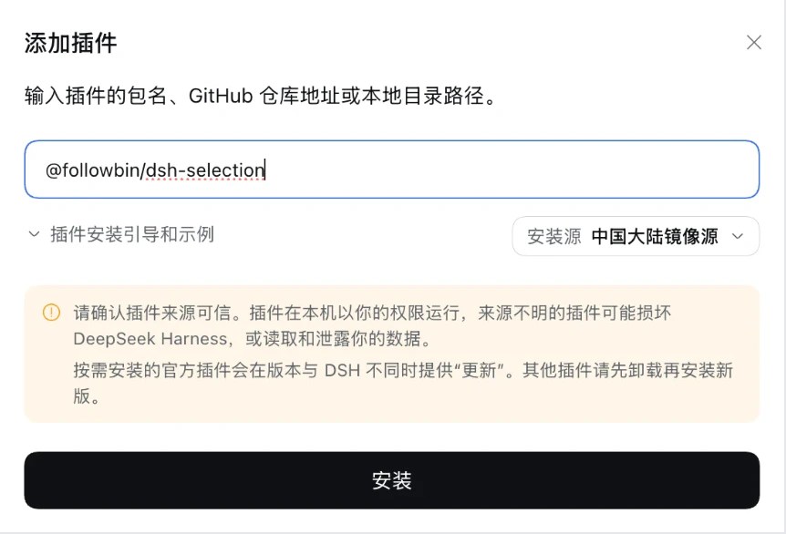
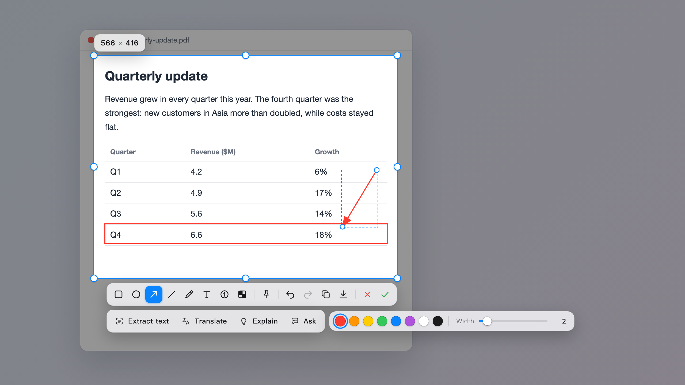
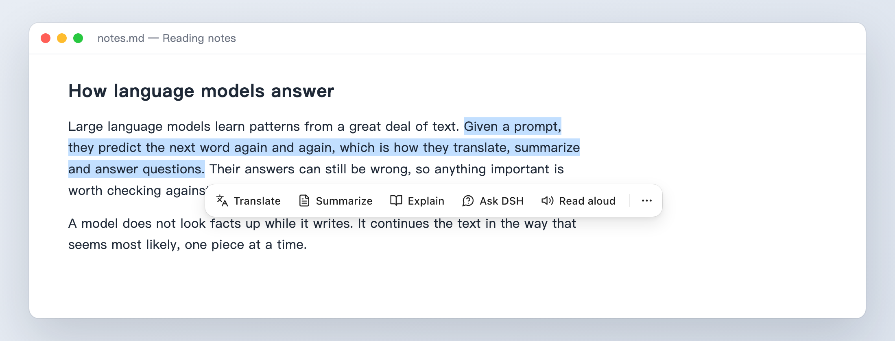
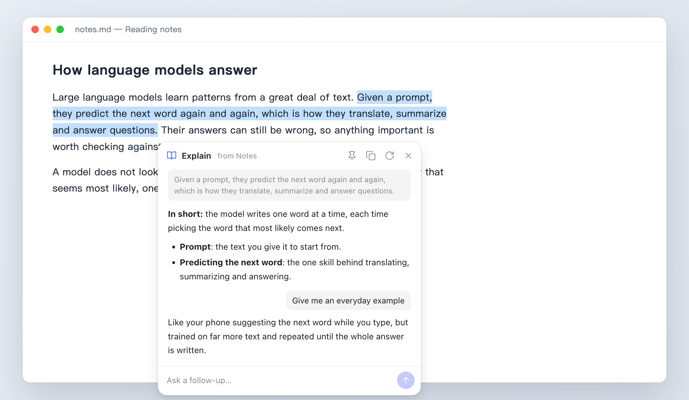
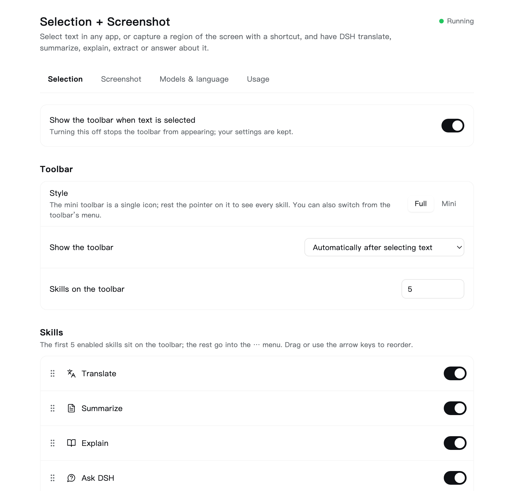
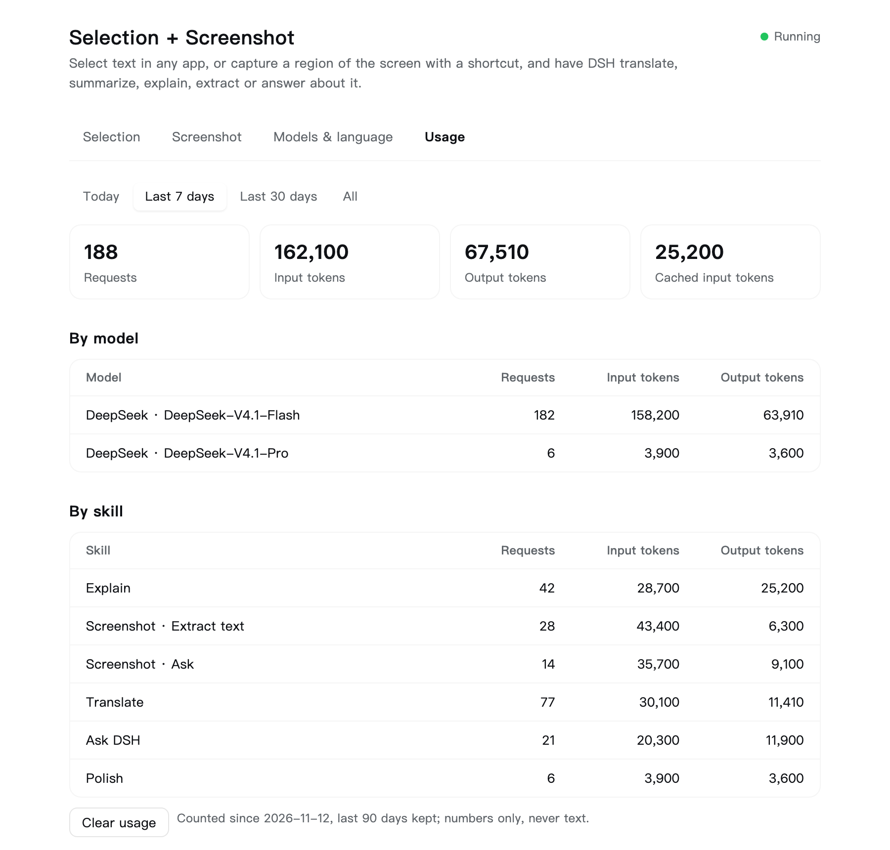

# dsh-selection — Selection + Screenshot

[中文](README.zh-CN.md)

Select text in any app and a small toolbar appears next to it: translate, summarize, explain, ask about it, read it aloud, copy, polish or search. Press ⌥D (Alt+D on Windows) to capture a region of any display: annotate it, pin it on screen, save it, or have AI extract, translate, explain or answer questions about it. Everything uses the models you already have in [DeepSeek Harness](https://github.com/deepseek-ai/deepseek-harness) (DSH).


## Install

You need DSH Desktop 0.2.2 or later, on macOS 14 or later or on Windows 10/11. The screenshots below show DSH in Chinese; the English interface is laid out the same way.

1. In DSH, open **Plugins** in the sidebar and click **Add plugin**.
2. Enter `@followbin/dsh-selection` and click **Install**.

   

3. When the dialog says **Installed**, click **Enable now**.

   

4. macOS asks whether "DeepSeek Harness" may control your computer using accessibility features. Choose *Open System Settings* (the highlighted default button is *Deny*) and switch DeepSeek Harness on ([why](#permissions-macos)).

   

Now select some text in any app. Settings are under **Selection assistant** in DSH's sidebar.

To install the newest code from GitHub instead, enter `https://github.com/followbin/dsh-selection` in step 2.

**Updating**: when a new version is published, the plugin's page under **Plugins** lists it in **Versions**; click **Update**. A copy installed from GitHub or a local folder has no **Versions** section: uninstall it and install it again. Your settings and usage are kept, because they are stored in `~/.dsh/selection`, outside the plugin.

## Features

### Selection

- **Toolbar**: the first few skills sit on the toolbar, the rest live in the ⋯ menu together with "Disable in this app" and "More settings…".
- **Mini toolbar**: a single icon instead; rest the pointer on it and every skill drops down. Switch between the two from the toolbar's menu or the settings page.
- **Built-in skills**: Translate, Summarize, Explain, Ask DSH, Read aloud, Copy, Polish, Search.
- **Custom skills**: a name, an icon and an instruction. Try them on sample text before saving.
- **Answers stream in** with Markdown, can be copied, regenerated, translated into another language or pinned on screen. When an answer is complete, a box below it takes follow-up questions, for every skill.
- **Stays out of the way**: the toolbar never takes focus from the app you are working in, never shows a Dock icon, and floats above full-screen apps.

### Screenshot


- **Every display at once**: the shortcut freezes each screen and you drag out a region; what you see while choosing and adjusting it is the screen itself, with a magnifier showing position and colour (⌘C / Ctrl+C copies the colour, Shift switches RGB/HEX).
- **Annotations**: rectangle, circle, arrow, line, pen, text, numbered markers and blur, each selectable to move, resize or restyle, with undo and redo.
- **Copy, save, pin**: Enter copies to the clipboard; a pin keeps the capture on screen, to drag, resize from its corners or zoom with the wheel. Esc leaves at any time.
- **Screenshot AI actions**: Extract text, Translate, Explain and Ask, plus your own (a name, an icon and an instruction, tried on any image before saving). Answers open in a panel beside the capture, with follow-ups, copy, regenerate and pin.
- **A shortcut registered with the system**: only the capture responds, the front app never sees the keys; the settings page says when another app holds them or they match a system shortcut.



### Shared

- **Uses DSH's own models**: requests go through the account or API key configured in DSH. Selections prefer DeepSeek Flash, screenshots use a model that reads images, both with thinking off for speed; either can be changed on the settings page.
- **Language**: your language, the translation direction and the answer language are one set for both.
- **Token usage**: the settings page counts requests and tokens per day, model, skill and screenshot action (numbers only, never text or images).

## Permissions (macOS)

Each permission is asked for when it is first needed, never both at once:

- **Accessibility (selection)**: when the plugin first runs, macOS asks whether **"DeepSeek Harness" may control your computer using accessibility features**. Choose *Open System Settings* and switch DeepSeek Harness on; it works within a second. Without it macOS hides the selection from every app, so the toolbar cannot appear.
- **Screen recording (screenshots)**: the first time you press the capture shortcut, macOS asks whether DeepSeek Harness may record the screen. Switch it on in System Settings → Privacy & Security → Screen & System Audio Recording; it takes effect without a restart. The shortcut itself needs no permission.

The settings page shows a notice for whichever permission is missing. Both are granted to the DeepSeek Harness app as a whole. macOS attributes it to every process DSH starts, including commands run by agents. If that is not acceptable for you, do not grant it. You can revoke it at any time in System Settings → Privacy & Security → Accessibility.

Windows needs no extra permission.

## Using it



- Select text and the toolbar appears below the selection. Press **Esc**, click elsewhere or start typing to dismiss it.
- With the mini toolbar, rest the pointer on the icon (or click it) to open the skills; they close once the pointer has left.
- **Ask DSH** opens a small chat about the selection. Type a question and press Enter; follow-up questions keep the context.
- Drag the toolbar, or a panel by its header, to move it; it stays where you put it.
- In a result panel, the pin keeps it open while you click elsewhere (a new selection still replaces it); the language menu re-translates into another language. Click into the answer to select part of it and copy with ⌘C.
- Once an answer is complete, type a follow-up in the box below it, for example "more formal" after a translation. Regenerating, or choosing another language, starts the conversation over.
- **⋯ → Use the mini toolbar** turns the toolbar into a single icon, and **Use the full toolbar** in its menu turns it back. **⋯ → Disable in this app** stops the toolbar in the current app. **⋯ → More settings…** opens the settings page in DSH.



## Settings

Open **Selection + Screenshot** in DSH's sidebar. The page has four tabs: **Selection** and **Screenshot** for each feature, and **Models & language** and **Usage**, which both share. Changes save automatically and apply immediately.

<p>
  
  
</p>

| Setting | Default | Notes |
| --- | --- | --- |
| Show the toolbar when text is selected | on | |
| Skills, their order, on/off | 8 built-ins | Drag, or focus the handle and press ↑ ↓. Custom skills can be edited and deleted. |
| Toolbar style | full | Mini is a single icon whose menu holds every skill. Also switchable from the toolbar's menu. |
| Show the toolbar | automatically | Or only while holding ⌥ / Alt during the selection. |
| Skills on the toolbar | 5 | The rest go into the ⋯ menu. Full toolbar only. |
| My language | 简体中文 | Auto translation goes into this language, or into English if the text is already in it. |
| Translate into | auto | |
| Summaries, explanations and answers in | my language | Or the language of the selected text, or a fixed language. |
| Model | auto | Auto prefers DeepSeek Flash. **Test** sends one short request. |
| Fall back to copying | on | For apps that do not expose the selection; your clipboard is restored afterwards. |
| Maximum characters sent | 4000 | |
| Search engine | Google | Bing, Baidu, DuckDuckGo, or any URL containing `%s`. |
| Never show in these apps | none | Recently used apps are offered for one-click adding. |

The **Usage** tab shows requests and input, output, cached and reasoning tokens for today, the last 7 days, the last 30 days and everything kept, split by model and by skill. It is stored in `selection/usage.json` (90 days, counts only) and can be cleared there.

Settings are stored in `selection/settings.json` under the DSH data directory.

## Privacy

- The selected text stays on your machine until you click a skill that needs a model. Only then is it sent, to the model route you chose in DSH.
- Captures stay on your machine too: copy, save and pin never touch the network. Only a screenshot AI action sends the selected region (with its annotations), through DSH's attachment store, to the vision model you chose. Text inside the image is treated as material; the model is told never to follow instructions in it.
- The toolbar process never talks to the network. Model calls are made by the DSH Host on its behalf.
- Selected text is treated as untrusted input: it is wrapped in `<selection>` tags and the model is told never to follow instructions inside it. Model output is rendered with a renderer that never emits raw HTML, and links open in your browser only after a click.
- The settings API answers only DSH's signed-in session, through the same check DSH's own routes use.
- The log (`selection/host.log` under the DSH data directory, usually `~/.dsh`) records events and counts, never text.
- No telemetry.

## Troubleshooting

- **"Cannot access GitHub" while installing**: enter the package name `@followbin/dsh-selection` instead of the GitHub address.
- **Installed, but no toolbar**: on the **Plugins** page, check that the plugin is switched on; closing the install dialog without **Enable now** leaves it off. If DSH says a change takes effect after a restart, restart DSH.
- **No toolbar on macOS**: check System Settings → Privacy & Security → Accessibility for DeepSeek Harness. The settings page shows a banner while the permission is missing.
- **No toolbar in one app**: check the disabled apps list. Some apps expose nothing to accessibility APIs; keep "Fall back to copying" on.
- **Model errors**: use **Test** on the settings page. "No model" means DSH has no usable model yet; sign in or add an API key in DSH.
- **The capture shortcut does nothing**: open the Screenshot tab and read the note under the shortcut: pick another combination if another app holds it. On macOS, a black capture or one with only the desktop means the screen-recording permission is missing; follow the notice at the top of the page.
- **Screenshot AI says no model can read images**: DSH needs a model with image input; use **Test** under Vision model on the Models & language tab.
- **Anything else**: look at `~/.dsh/selection/host.log`, then use **Restart the assistant** or **Restart the screenshot process** on the settings page.

## Known limitations

- On Windows:
  - apps running as administrator cannot be read, since Windows keeps ordinary processes out of them;
  - Smart App Control may block unsigned native modules;
  - displays with different scale factors have not been tried yet; there the toolbar might land off the selection.
- On macOS the toolbar does not appear while secure input is on (password fields), by design of the OS.
- The toolbar process is DSH's own Electron executable in Node mode. Electron Framework and the web view library both define an Objective-C class named `NotificationCenterDelegate`, which prints a harmless warning at start.
- Text-to-speech uses the system voices; quality depends on what is installed.
- Screenshots on Windows are implemented but have not run on real hardware yet: several displays, mixed scale factors and pin translucency (a layered window) need trying.
- Selection and screenshots each run in their own background process, so a fault in one never takes the other down; the cost is some extra memory.

## Development

DSH Desktop runs plugins on Electron 44 in Node mode (Node 24), and `@webviewjs/webview` needs Node 24. Install the dependencies with DSH's own runtime:

```bash
env ELECTRON_RUN_AS_NODE=1 "/Applications/DeepSeek Harness.app/Contents/MacOS/DeepSeek Harness" \
  "/Applications/DeepSeek Harness.app/Contents/Resources/runtime/primary-runtime/dependencies/pnpm/bin/pnpm.mjs" install
```

To run your checkout inside DSH, quit DSH and link the checkout with DSH's command-line tool:

```bash
"/Applications/DeepSeek Harness.app/Contents/Resources/runtime/cli/bin/dsh" plugin --profile desktop add link:/path/to/dsh-selection
```

After changing `src/worker/` or `ui/`, click **Restart the assistant** on the settings page. Changes to `index.js`, `client.js` or `src/host/` need a DSH restart.

| Command | What it does |
| --- | --- |
| `pnpm test` | Unit tests for the Host (settings, prompts, model client, HTTP guards, worker messages), the worker's rules, the toolbar page and the settings page (the pages run in jsdom). Plain Node 20 or later is fine. |
| `pnpm selftest` | Opens the toolbar, the ⋯ menu and both panel types, then checks native window state, layout and that the frontmost app never changes. No permission needed. Add `--interactive` to click around for 20 seconds. |
| `pnpm dev` | Runs the real toolbar outside DSH with a demo model. Settings go to `~/.dsh/selection-dev`. On macOS the accessibility prompt is for your terminal app. |
| `pnpm screenshots` | Redraws the toolbar, follow-up, settings, walkthrough and screenshot images in `docs/images/` from the real pages (toolbar, settings, capture overlay, answer panel) with sample content; the install screenshots are taken by hand. Add `en` or `zh` for one language, `selection` or `capture` for one part. Needs Google Chrome and ffmpeg. |
| `pnpm vendor:selection-hook [version]` | Refreshes `vendor/selection-hook` from npm. |

How the pieces fit together, and why some unusual choices were made, is in [docs/architecture.md](docs/architecture.md).

## License

MIT. See [LICENSE](LICENSE) and [THIRD_PARTY_NOTICES.md](THIRD_PARTY_NOTICES.md).
