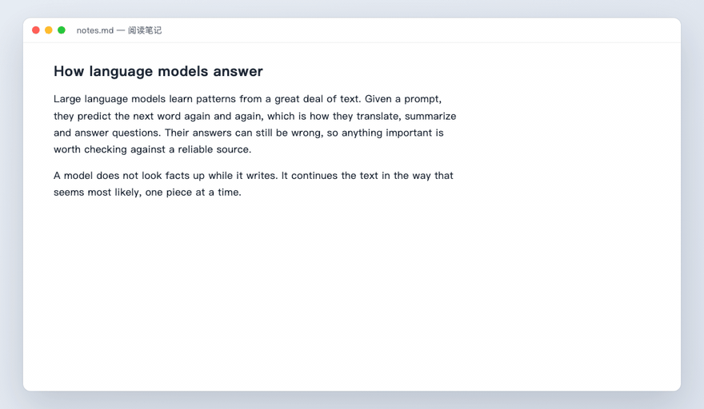
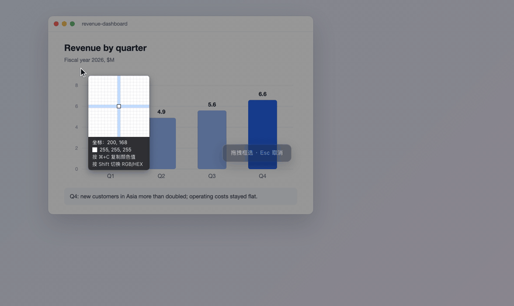
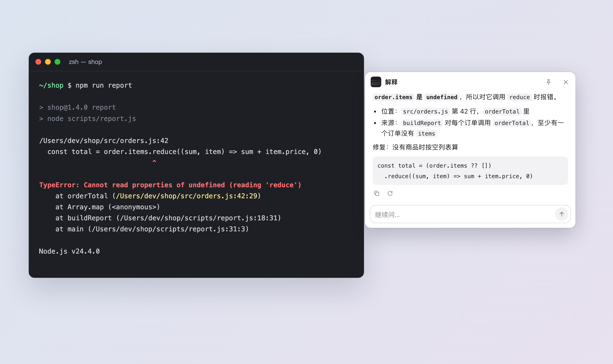
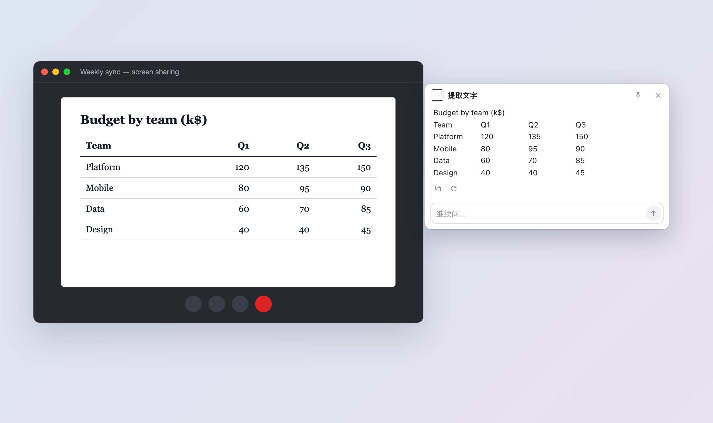
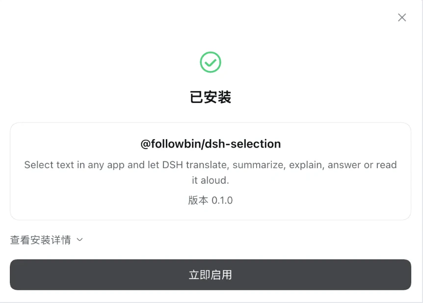
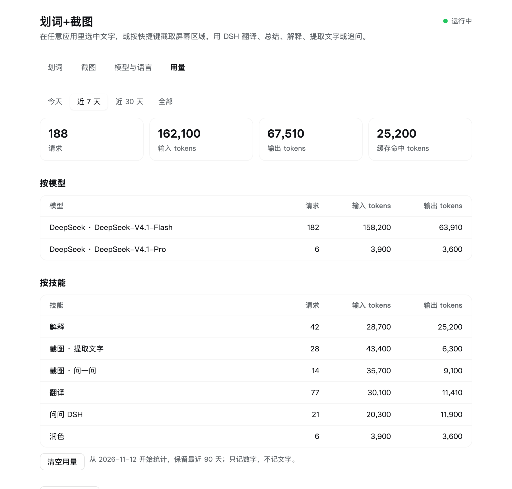

# 划词+截图

[English](README.md) · [DeepSeek Harness](https://github.com/deepseek-ai/deepseek-harness) 插件 · `@followbin/dsh-selection`

**选中文字或框选屏幕，就地让 AI 处理。** 翻译、解释、总结、提取文字、回答问题，结果出现在原处，还能接着追问。用的是你在 DeepSeek Harness（DSH）里已经配好的模型，不需要另外的 API Key。

## 划词：选中就能问



- **任意应用里选中文字**，旁边就出现工具栏：翻译、总结、解释、问问 DSH、润色、朗读、复制、搜索。
- **回答就地流式显示**，下面直接追问，上下文保留，比如「再正式一点」「举个例子」。
- **一句指令就是一个新技能**：起个名字、选个图标、写下要它做什么。
- 不抢焦点，能浮在全屏应用之上；嫌占地方可以换成只有一个图标的迷你模式。

## 截图：框出来问 AI



- **⌥D（Windows 上 Alt+D）框选任意显示器上的区域**，交给能看图的模型：
  - **提取文字**：图片、扫描件、共享屏幕里的字都能拿出来，表格保持行列，可以直接贴进表格软件；
  - **翻译**、**解释**（报错、图表、界面）、**问一问**任何问题；也可以添加自己的截图 AI 功能。
- **先圈重点再问**：方框、箭头等标注会随图一起发给模型。
- **回答出现在截图旁边**，可以追问、复制、固定。
- 本身也是完整的截图工具：标注、复制、保存、钉在屏幕上（贴图）。

<p>
  
  
</p>

## 安装

需要 DSH 桌面版 0.2.2 及以上，macOS 14 及以上或 Windows 10/11。

1. 在 DSH 侧边栏打开「插件」，点「添加插件」，输入 `@followbin/dsh-selection`，点「安装」。

   

2. 显示「已安装」后，点「立即启用」。

   

3. macOS 会请求「辅助功能」权限：点「打开系统设置」（高亮的默认按钮是「拒绝」，别直接按回车），把 DeepSeek Harness 打开。

   

装好后在任意应用里选中一段文字，或按 ⌥D 试试。设置在 DSH 侧边栏的「划词+截图」里。

- **更新**：在「插件」里打开它，「版本」一栏出现新版本时点「更新」。
- **装 GitHub 上的最新代码**：第 1 步改填 `https://github.com/followbin/dsh-selection`；这样装的没有「版本」一栏，更新要先卸载再重装。
- 设置和用量存在 `~/.dsh/selection`，卸载插件不会丢。

## 权限（macOS）

两项权限都授给 DeepSeek Harness，各在第一次用到时才申请，不会一起弹出：

| 权限 | 什么时候问 | 用来做什么 |
| --- | --- | --- |
| 辅助功能 | 插件第一次运行 | 读取选中的文字。没有它，工具栏不会出现。 |
| 录屏与系统录音 | 第一次按 ⌥D | 读取屏幕内容。授权后自动生效，不用重启。 |

截图快捷键本身不需要权限。缺哪项，设置页顶部会提示。

注意：macOS 会把这些权限算到 DSH 启动的所有进程头上，包括 agent 执行的命令。不能接受就别授权；之后也可以在「系统设置 → 隐私与安全性」里随时关掉。Windows 不需要额外权限。

## 使用

**划词**

- 选中文字后，工具栏出现在选区下方；按 Esc、点别处或开始打字会收起。
- 「问问 DSH」打开一个针对这段文字的对话框。每个回答下面都可以接着问；重新生成或换语言会从头开始。
- 工具栏和面板可以拖开；面板上的图钉把它固定在屏幕上，翻译面板可以换目标语言重译。
- 「⋯」菜单：切换迷你模式、在当前应用里禁用、打开设置。

**截图**

- 按 ⌥D 冻结所有屏幕，拖出区域，之后还能拖动或拉伸。鼠标旁的放大镜显示坐标和颜色：⌘C 复制颜色值，Shift 切换 RGB/HEX。
- 区域下方第一行是标注工具和操作，第二行是 AI 功能；点「问一问」会出现输入框。
- 快捷键：回车或 ⌘C 复制 · ⌘S 保存 · ⌘P 贴图 · ⌘Z 撤销 · Delete 删除选中的标注 · Esc 退出。Windows 上用 Ctrl 代替 ⌘。
- 贴图可以拖动、拖角缩放、滚轮缩放，按住 ⌥ 滚动调透明度。

## 设置

在 DSH 侧边栏打开「划词+截图」，改动自动保存、立即生效。

| 页签 | 主要内容 |
| --- | --- |
| 划词 | 开关；工具栏样式（常规或迷你）和弹出方式（选中即弹，或按住 ⌥ / Alt 才弹）；技能的顺序、开关和自定义技能；读不到选区时用复制兜底、最多发送的字数、搜索引擎；不弹出的应用。 |
| 截图 | 开关；快捷键（默认 ⌥D / Alt+D，被占用或和系统快捷键冲突时会提示）；保存位置（默认桌面）；截图 AI 功能的顺序、开关和自定义功能（最多 12 个，保存前可以拿图片试）。 |
| 模型与语言 | 母语、翻译方向、回答语言，划词和截图共用；划词模型（默认优先 DeepSeek Flash）和看图模型，都能一键测试。 |
| 用量 | 按天、模型、技能统计请求次数和 token，只记数字，保留 90 天。 |

<p>
  
  
</p>

## 隐私

- 文字和截图都留在本机。只有你点了要用模型的功能，选中的文字或框选的区域（含标注）才会发给你在 DSH 里选的模型；复制、保存、贴图都不联网。
- 选中的文字和图里的内容只当作材料，模型不会执行其中的指令；回答经过不输出原始 HTML 的渲染器，链接点了才打开。
- 模型请求由 DSH 发出，插件的后台进程不联网；设置接口只响应 DSH 已登录的会话。
- 日志（`~/.dsh/selection/host.log`）只记事件和计数，不记内容。没有遥测。

## 常见问题

- **安装时提示「无法访问 GitHub」**：点「改用国内镜像」，再填包名 `@followbin/dsh-selection` 安装。
- **装好了但没反应**：在「插件」页确认它已启用（装完没点「立即启用」就是关着的）；DSH 提示重启时重启一下。
- **macOS 上不弹工具栏**：确认「系统设置 → 隐私与安全性 → 辅助功能」里 DeepSeek Harness 已打开。只在某个应用里不弹，先看它是否在禁用列表里，并保持「复制兜底」开启。
- **截图快捷键没反应**：看设置页「截图」页签里快捷键下面的提示，被别的软件占用就换一组。截出来是黑的或只有桌面，说明缺录屏权限。
- **模型报错**：在「模型与语言」页签点「测试」。提示没有可用模型时，去 DSH 里登录或填 API Key；截图 AI 需要支持图片输入的模型。
- **其他问题**：看 `~/.dsh/selection/host.log`，在设置页点「重启划词进程」或「重启截图进程」。

## 已知限制

- macOS 开启安全输入时（比如焦点在密码框里），系统不交出选区，工具栏不会出现。
- Windows 上读不到以管理员身份运行的应用里的选区；开了「智能应用控制」的系统可能拦截未签名的原生模块；截图已在 Windows 真机上试过，多显示器且缩放比不同的组合还没试过。
- 朗读用系统语音，效果取决于系统里装了哪些语音。
- 划词和截图各在一个后台进程里运行，一个出问题不会带倒另一个，代价是多占一些内存。

## 开发

DSH 桌面版在 Electron 的 Node 模式（Node 24）里运行插件，`@webviewjs/webview` 也要求 Node 24，所以装依赖用 DSH 自带的运行时：

```bash
env ELECTRON_RUN_AS_NODE=1 "/Applications/DeepSeek Harness.app/Contents/MacOS/DeepSeek Harness" \
  "/Applications/DeepSeek Harness.app/Contents/Resources/runtime/primary-runtime/dependencies/pnpm/bin/pnpm.mjs" install
```

在 DSH 里跑本地代码：先退出 DSH，再把目录链接进去。之后改了 `src/worker/`、`src/capture/worker/` 或 `ui/`，在设置页重启对应进程即可；改了 `index.js`、`client.js`、`src/host/` 或 `src/capture/host/`，要重启 DSH。

```bash
"/Applications/DeepSeek Harness.app/Contents/Resources/runtime/cli/bin/dsh" plugin --profile desktop add link:/path/to/dsh-selection
```

| 命令 | 作用 |
| --- | --- |
| `pnpm test` | 单元测试：Host、两个后台进程的行为规则、工具栏页面和设置页（跑在 jsdom 里）。Node 20 及以上即可。 |
| `pnpm selftest` | 打开真实的工具栏、菜单和结果面板，检查原生窗口状态和布局，并确认前台应用始终没变。加 `--interactive` 可以手动点 20 秒。 |
| `pnpm dev` | 不经过 DSH、用演示模型运行真实的工具栏，设置存在 `~/.dsh/selection-dev`。 |
| `pnpm screenshots` | 用真实页面和示例内容重新生成 `docs/images/` 里的图片和动图（安装步骤的截图是手工截的）。加 `zh` / `en` 只生成一种语言，加 `selection` / `capture` 只生成划词或截图部分。需要 Google Chrome 和 ffmpeg。 |
| `pnpm vendor:selection-hook [版本]` | 从 npm 更新 `vendor/selection-hook`。 |

截图界面的浏览器测试：`node test/capture/build-harness.mjs` 生成 `test/capture/harness.html`，在浏览器里打开后运行 `await window.__cases.run()`。各部分怎么协作，见 [docs/architecture.md](docs/architecture.md)。

## 许可证

MIT，见 [LICENSE](LICENSE) 和 [THIRD_PARTY_NOTICES.md](THIRD_PARTY_NOTICES.md)。
