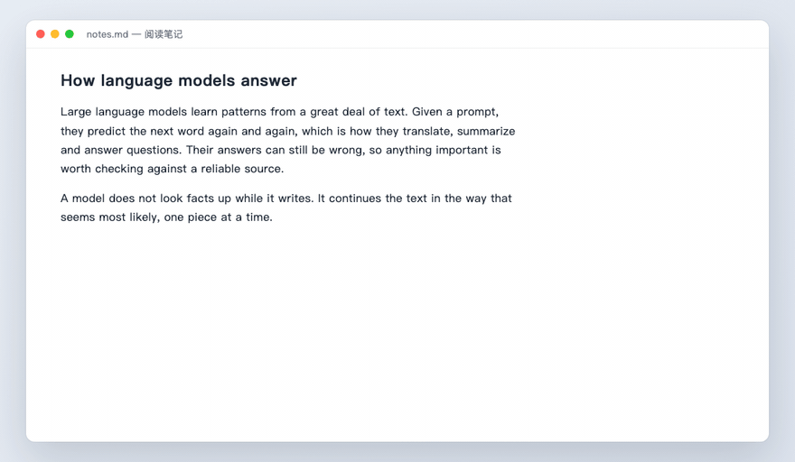
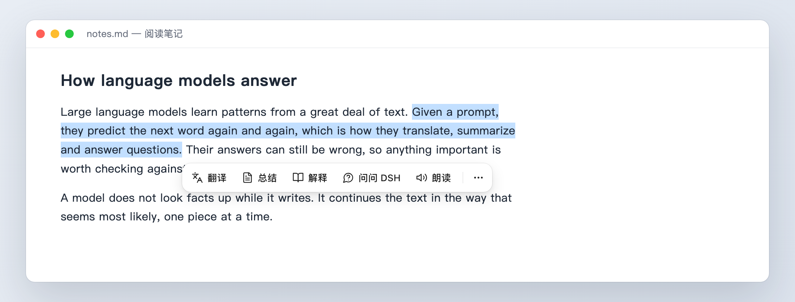
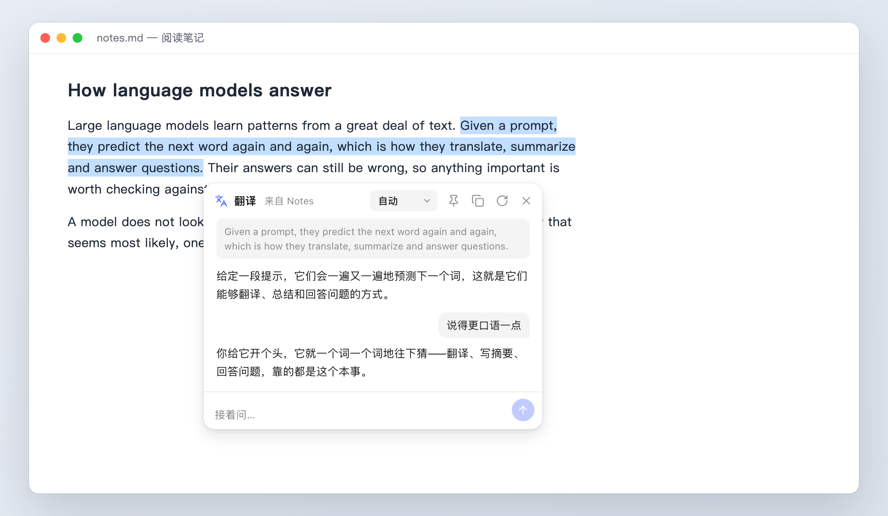
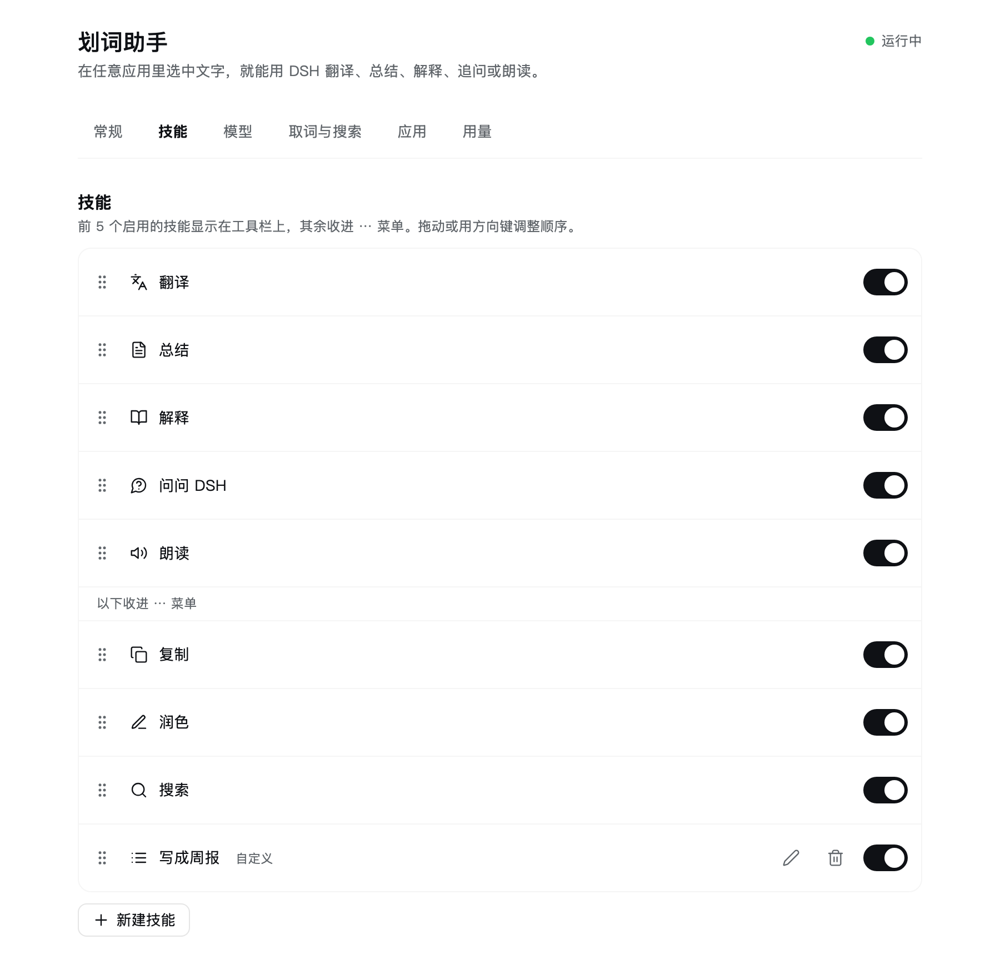
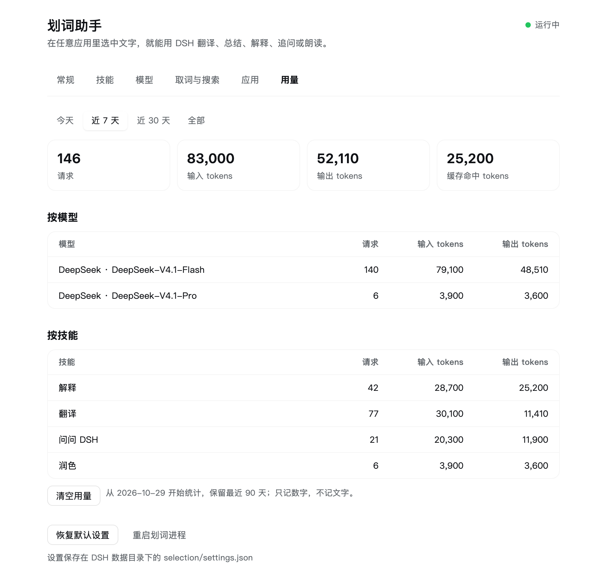

# dsh-selection 划词助手

[English](README.md)

在任意应用里选中文字，旁边就会出现一个小工具栏：翻译、总结、解释、追问、朗读、复制、润色、搜索。用的是你在 [DeepSeek Harness](https://github.com/deepseek-ai/deepseek-harness)（DSH）里已经配好的模型。



## 安装

需要 DSH 桌面版 0.2.2 及以上、macOS 14 及以上。Windows 的支持已经写好，但还没测过，见[已知限制](#已知限制)。

1. 在 DSH 侧边栏打开「插件」，点「添加插件」。
2. 输入 `dsh-selection`，点「安装」。
3. 显示「已安装」后，点「立即启用」。
4. macOS 会询问是否允许「DeepSeek Harness」使用辅助功能控制这台电脑。点「打开系统设置」，把 DeepSeek Harness 打开（[为什么需要](#权限macos)）。

然后在任意应用里选中一段文字试试。设置在 DSH 侧边栏的「划词助手」里。

想装 GitHub 上的最新代码，第 2 步改填 `https://github.com/followbin/dsh-selection`。

**更新**：发布新版本后，在「插件」里打开它，「版本」一栏会列出新版本，点「更新」即可。从 GitHub 或本地目录装的没有「版本」一栏，要先卸载再重新安装。设置和用量存在 `~/.dsh/selection`，不在插件目录里，卸载不会丢。

## 功能

- **工具栏**：前几个技能直接显示，其余收进「⋯」菜单；菜单里还有「在此应用中禁用」和「更多设置…」。
- **内置技能**：翻译、总结、解释、问问 DSH、朗读、复制、润色、搜索。
- **自定义技能**：起个名字、选个图标、写一句指令，保存前可以拿示例文字试一试。
- **结果面板**：流式显示，支持 Markdown，可以复制、重新生成、切换翻译语言、固定在屏幕上。每个技能回答完后，下面都有输入框可以接着问。
- **token 用量**：设置页按天、模型、技能统计请求次数和 token（只记数字，不记文字）。
- **用 DSH 自己的模型**：请求走 DSH 里配置的账号或 API Key。默认优先 DeepSeek Flash 并关闭思考以加快速度，也可以选 DSH 里的其他模型。
- **不打扰**：工具栏不抢当前应用的焦点，不出现 Dock 图标，能浮在全屏应用之上。

## 权限（macOS）

插件第一次运行时，macOS 会询问：**「DeepSeek Harness」想使用辅助功能来控制这台电脑**。点「打开系统设置」，把 DeepSeek Harness 打开即可。一秒内生效，不用重启任何东西。没有这项权限，macOS 不会把任何应用里选中的文字交出来，工具栏也就无法出现。

这项权限是授给整个 DeepSeek Harness 的。macOS 会把它算到 DSH 启动的所有进程头上，包括 agent 执行的命令。如果你不能接受，就别授权；之后也可以随时在「系统设置 → 隐私与安全性 → 辅助功能」里关掉。

Windows 不需要额外权限。

## 使用



- 选中文字后，工具栏出现在选区下方。按 **Esc**、点别处或开始打字都会收起它。
- **问问 DSH** 会打开一个针对这段文字的小对话框。输入问题后按回车，追问会保留上下文。
- 按住工具栏，或按住面板的标题栏拖动，可以把它移开；放下后就停在那里。
- 结果面板上的图钉可以把面板固定住，点别处也不会收起（再次划词仍会替换它）；翻译面板的语言下拉框可以换一种语言重新翻译。在回答里点一下，就能选中其中一部分并用 ⌘C 复制。
- 回答完成后，可以在下方输入框里接着问，比如翻译完问「再正式一点」。点重新生成或换一种语言时，对话会从头开始。
- **⋯ → 在此应用中禁用** 会让当前应用里不再弹出；**⋯ → 更多设置…** 会打开 DSH 里的设置页。



## 设置项

在 DSH 侧边栏打开「划词助手」。页面分成常规、技能、模型、取词与搜索、应用、用量几个页签。改动会自动保存并立即生效。

<p>
  
  
</p>

| 设置 | 默认值 | 说明 |
| --- | --- | --- |
| 选中文字时显示工具栏 | 开 | |
| 技能、顺序与开关 | 8 个内置技能 | 拖动排序，也可以聚焦拖动把手后按 ↑ ↓。自定义技能可以编辑、删除。 |
| 弹出方式 | 选中后自动弹出 | 也可以设为按住 ⌥ / Alt 选中时才弹出。 |
| 工具栏上的技能数 | 5 | 其余收进「⋯」菜单。 |
| 我的母语 | 简体中文 | 自动翻译会译成母语；原文已经是母语时译成英文。 |
| 翻译成 | 自动 | |
| 总结、解释和回答使用 | 我的母语 | 也可以跟随原文的语言，或固定某种语言。 |
| 模型 | 自动 | 自动时优先 DeepSeek Flash。点「测试」会发一次简短请求。 |
| 读不到选区时用复制兜底 | 开 | 有些应用不提供选中文字，这时会模拟一次复制，之后恢复你原来的剪贴板。 |
| 最多发送的字数 | 4000 | |
| 搜索引擎 | Google | 也可以选 Bing、百度、DuckDuckGo，或任何带 `%s` 的地址。 |
| 不在这些应用里弹出 | 无 | 最近划过词的应用可以一键加入。 |

「用量」页签按今天、近 7 天、近 30 天和全部，显示请求次数和输入、输出、缓存命中、推理 token，并按模型、按技能拆开。数据存在 `selection/usage.json`，只记数字、保留 90 天，可以在页面上清空。

设置保存在 DSH 数据目录下的 `selection/settings.json`。

## 隐私

- 选中的文字留在本机。只有你点了要用模型的技能，它才会发给你在 DSH 里选的模型。
- 工具栏进程本身不联网，模型请求由 DSH Host 代为发出。
- 选中的文字被当作不可信输入：包在 `<selection>` 标签里，并告诉模型不要执行其中的任何指令。模型输出经过一个不会产生原始 HTML 的渲染器；链接只有在点击后才会用浏览器打开。
- 设置接口只响应 DSH 已登录的会话，用的是和 DSH 自带接口相同的校验。
- 日志（DSH 数据目录下的 `selection/host.log`，通常在 `~/.dsh`）只记录事件和计数，不记录文字内容。
- 没有任何遥测。

## 常见问题

- **安装时提示「无法访问 GitHub」**：点「改用国内镜像」，再填包名 `dsh-selection` 安装。镜像只提供 npm 包，不提供 GitHub 仓库。
- **装好了但不弹工具栏**：到「插件」页确认 dsh-selection 的开关已打开；安装完没点「立即启用」就关掉对话框，插件是关着的。如果 DSH 提示重启后生效，重启一下 DSH。
- **macOS 上不弹工具栏**：到「系统设置 → 隐私与安全性 → 辅助功能」确认 DeepSeek Harness 已打开。缺这项权限时，设置页顶部会有提示。
- **某个应用里不弹**：先检查是否在禁用列表里。有些应用不向辅助功能接口提供任何内容，这种情况保持「复制兜底」开启即可。
- **模型报错**：在设置页点「测试」。提示「没有可用的模型」时，去 DSH 里登录或填写 API Key。
- **其他问题**：查看 `~/.dsh/selection/host.log`，再在设置页点「重启划词进程」。

## 已知限制

- **Windows 还没在真机上跑过**。钩子、WebView2、不抢焦点的窗口、SAPI 朗读都写了，但可能还有毛病。另外几点：
  - 多显示器且缩放比不同时，工具栏可能落到别的显示器上或偏离选区，点它也可能被当成点在外面；
  - 工具栏四周的透明边距可能挡住对下面应用的点击；
  - 以管理员身份运行的应用读不到选区；
  - 开了「智能应用控制」的系统可能会拦截未签名的原生模块。
- macOS 开启安全输入时（比如焦点在密码框里），系统不会交出选区，工具栏不会出现。
- 工具栏进程用的是 DSH 自己的 Electron 可执行文件（Node 模式）。Electron Framework 和 webview 库都定义了名为 `NotificationCenterDelegate` 的 Objective-C 类，启动时会打一条无害的警告。
- 朗读用的是系统语音，效果取决于系统里装了哪些语音。

## 开发

DSH 桌面版在 Electron 44 的 Node 模式（Node 24）里运行插件，而 `@webviewjs/webview` 要求 Node 24，所以装依赖用 DSH 自带的运行时：

```bash
env ELECTRON_RUN_AS_NODE=1 "/Applications/DeepSeek Harness.app/Contents/MacOS/DeepSeek Harness" \
  "/Applications/DeepSeek Harness.app/Contents/Resources/runtime/primary-runtime/dependencies/pnpm/bin/pnpm.mjs" install
```

要在 DSH 里跑本地代码，先退出 DSH，再用 DSH 自带的命令行工具把目录链接进去：

```bash
"/Applications/DeepSeek Harness.app/Contents/Resources/runtime/cli/bin/dsh" plugin --profile desktop add link:/path/to/dsh-selection
```

改了 `src/worker/` 或 `ui/`，在设置页点「重启划词进程」即可；改了 `index.js`、`client.js` 或 `src/host/`，要重启 DSH。

| 命令 | 作用 |
| --- | --- |
| `pnpm test` | 单元测试：Host（设置、提示词、模型调用、HTTP 防护、worker 消息）、worker 的行为规则、工具栏页面和设置页（页面跑在 jsdom 里）。普通 Node 20 及以上就能跑。 |
| `pnpm selftest` | 依次打开工具栏、「⋯」菜单和两种结果面板，检查原生窗口状态、布局，以及前台应用始终没变。不需要权限。加 `--interactive` 可以手动点 20 秒。 |
| `pnpm dev` | 不经过 DSH、用演示模型运行真实的工具栏，设置存在 `~/.dsh/selection-dev`。在 macOS 上，授权弹窗针对的是你的终端应用。 |
| `pnpm screenshots` | 用真实的工具栏页面和设置页、配上示例文字，重新生成 `docs/images/` 里的图。加 `en` 或 `zh` 只生成一种语言。需要 Google Chrome 和 ffmpeg。 |
| `pnpm vendor:selection-hook [版本]` | 从 npm 更新 `vendor/selection-hook`。 |

各部分怎么协作、为什么有些做法不寻常，见 [docs/architecture.md](docs/architecture.md)。

## 许可证

MIT，见 [LICENSE](LICENSE) 和 [THIRD_PARTY_NOTICES.md](THIRD_PARTY_NOTICES.md)。
